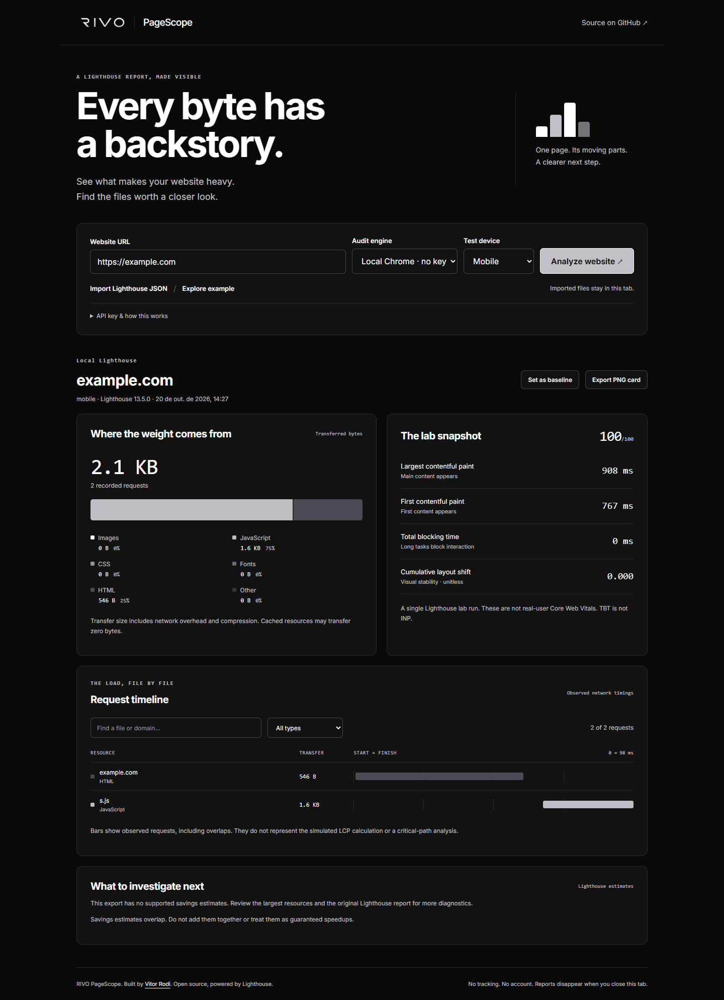

# RIVO PageScope

**See what makes a website heavy.** RIVO PageScope turns Lighthouse JSON reports into a visual breakdown of page weight, network requests, and lab metrics. Built with React and TypeScript, using RIVO's black, white, graphite, and silver identity.



## What you can do

- Audit a public URL on mobile or desktop using local Chrome, without an API key.
- Optionally switch to Google PageSpeed Insights for a remote audit.
- Import Lighthouse or PageSpeed JSON files locally, without uploading them.
- See transferred bytes grouped into images, JavaScript, CSS, fonts, HTML, and other resources.
- Filter a request waterfall by filename, domain, or resource type.
- Inspect LCP, FCP, TBT, CLS, and the Lighthouse performance score.
- Set a report as the baseline, then analyze or import a second run to compare changes.
- Export a 1200 × 675 PNG summary card. No automatic social posting.
- Explore an explicitly labeled, synthetic example without calling any API.

## Run locally

Requires **Node.js 22.19+** (Node 24 also works) and npm.

```sh
git clone https://github.com/VitorRodi/rivo-pagescope.git
cd rivo-pagescope
npm ci
npm run dev
```

Open the local address printed by Vite. **Local Chrome is selected by default** on localhost. Enter a website URL and select **Analyze website**; the local engine runs Lighthouse and displays the report automatically. Chrome must be installed. No API key, JSON import, database, or account is needed for this flow.

Vite's development and preview servers include a local-only audit endpoint. It accepts same-origin requests from the loopback interface, validates the URL/device, runs one audit at a time, and cancels Chrome when the client disconnects. Do not expose this development server as a public audit service. A static deployment of `dist/` has no local Chrome endpoint: it supports Google PageSpeed and JSON import instead.

### Get a real report without an API key

Requires Google Chrome installed. Lighthouse runs in a separate temporary browser profile.

```sh
npm run audit -- https://example.com
npm run audit -- https://example.com --device=desktop
```

Import the generated file from `reports/` into PageScope. This command visits the target website from your own computer. Only audit websites you are allowed to test. Generated reports are gitignored.

Alternatively, open Chrome DevTools → Lighthouse, run a navigation performance audit, and export it as **JSON**. Raw Lighthouse reports and PageSpeed responses containing `lighthouseResult` are supported. Import limit: 20 MB per file.

### URL audits and API quota

With **Local Chrome**, the website is visited from your computer in a temporary browser profile, and no Google API request is made. The result appears directly in the app. Only audit websites you are allowed to test.

With **Google PageSpeed** selected, **Analyze website** sends your URL to the [PageSpeed Insights API](https://developers.google.com/speed/docs/insights/v5/get-started). Anonymous quota may be exhausted; development and browser reproduction both confirmed HTTP 429. The local engine avoids this dependency on localhost.

You can optionally enter your own Google PageSpeed API key under **API key & how this works**. It is kept only in React memory and sent directly to Google. Do not commit keys. Restrict browser keys to the PageSpeed API and your website's HTTP referrers. This is a browser-visible key, not a server secret.

If the public quota is unavailable, switch to Local Chrome when using this app locally. The local command and DevTools JSON import remain available. A successful live Google audit with a user-provided key has not been verified.

## Before and after

1. Analyze a URL or import a measured report.
2. Select **Set as baseline**.
3. Change your website and run the audit again with the same device and settings.
4. Import the new report, or analyze the same URL again.

Negative byte and timing deltas mean less; positive score deltas mean higher. Different URLs, device settings, throttling/screen settings, or Lighthouse versions produce comparison warnings. Run repeated measurements under equivalent conditions before claiming a performance improvement. No percentage speedup is inferred from a score change.

## Measurement boundaries

- These are single **lab runs**, not real-user Core Web Vitals. TBT is not INP.
- Resource bars use **transferred bytes**, including network overhead and compression. They do not represent decoded memory size. Cached resources can transfer zero bytes.
- The waterfall uses observed network timing fields from the report. It does not reconstruct the critical path or the simulated LCP calculation. Current millisecond fields and older seconds-based fields are supported.
- Missing metrics remain unavailable. Limited exports can omit request rows or savings estimates. The waterfall displays at most 100 matching requests at a time.
- Lighthouse opportunity savings can overlap. They are estimates, not guaranteed improvements. Newer insight formats without `overallSavingsMs` / `overallSavingsBytes` may not appear in the opportunities section; the original report remains the source of truth.
- The built-in example is hand-authored and labeled synthetic throughout the interface and PNG export. It is not evidence about example.com or a client website.

## Privacy

Imported files, baseline reports, and API keys remain in memory; closing or reloading the tab clears them. There are no analytics, cookies, localStorage, or sessionStorage writes. Imports do not trigger remote requests for report resources. Local Chrome visits the target website from a temporary local browser profile; Google PageSpeed sends the target URL to Google. The local endpoint returns its report without writing a report file (the separate CLI command saves to `reports/`). Exporting a card downloads a PNG locally. Reports may contain sensitive URLs and query parameters: inspect files before sharing them. The summary card includes the hostname, not the query string.

## Verify

```sh
npm test
npm run build
npm run test:e2e
```

Browser tests use a separate, headless Chrome instance. Install Chrome first, or run `npx playwright install chrome` if needed. CI installs its browser explicitly. Tests cover URL validation, report parsing, unknown data, timing units, comparison warnings, importing, quota failures, filtering, PNG download, and mobile layout. They do not claim that a synthetic fixture is a live Google audit.

## Structure

```text
src/report.ts          Parse reports, validate URLs, compare runs
src/main.tsx           React workbench and API/import flow
src/card.ts            Local PNG export
src/example.ts         Labeled illustrative data
scripts/audit.mjs      Local Lighthouse runner
tests/                 Parser/CLI tests and browser flows
```

## Credits

[Lighthouse](https://github.com/GoogleChrome/lighthouse) supplies the underlying audits and [PageSpeed Insights](https://developers.google.com/speed/docs/insights/v5/reference/pagespeedapi/runpagespeed) supplies remote runs. RIVO PageScope is a visualization project by [Vitor Rodi](https://github.com/VitorRodi), not a Google product. Lighthouse is Apache-2.0; the original application code is MIT licensed. Inter is bundled under SIL OFL 1.1. RIVO logos are preserved brand assets; the software license does not grant trademark rights.
